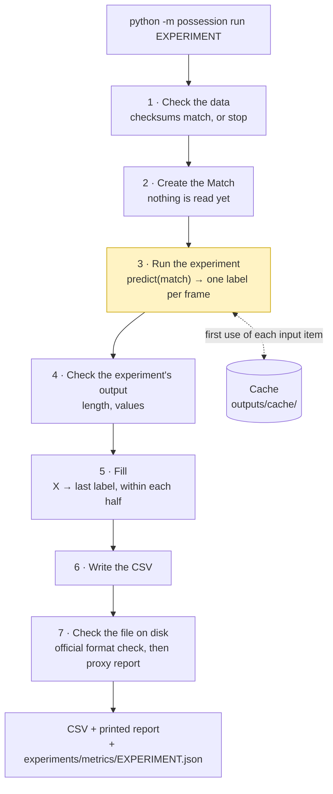
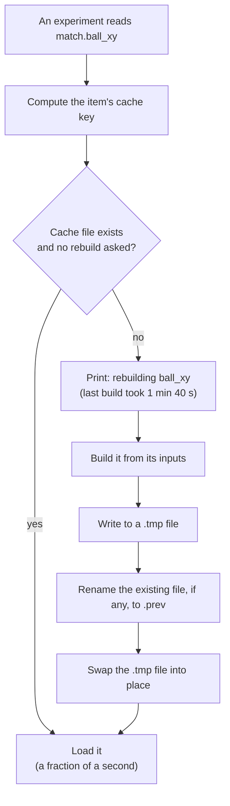
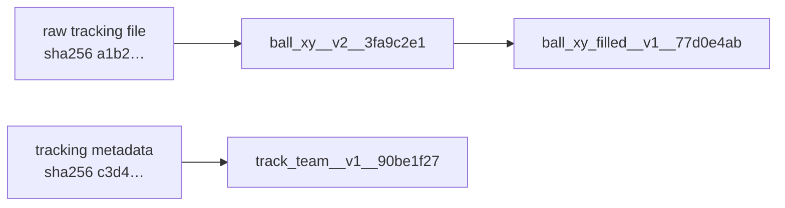

# 0002: How an experiment runs, from data files to a checked CSV

- Status: accepted
- Date: 2026-11-09
- Issue: #4

## Context

The challenge asks for one CSV: for each of the 199,319 frames of the tactical video, a label saying
who has the ball (`H` home, `A` away, `D` dead ball, `X` no answer). See [CONTEXT.md](../../CONTEXT.md)
for the terms.

We will try many methods ("experiments") over about a week, often in parallel sessions. Four facts
shape how they should run:

- **Reading the inputs is slow.** The tracking file alone is 199,319 lines and takes a minute or two
  to parse; anything we derive from the video will take far longer. It has to be done once and
  reused.
- **The final CSV must regenerate exactly**, byte for byte, from the repository with one documented
  command (RULES.md). So the path from data to CSV must be fixed and deterministic.
- **Every experiment needs the same surrounding steps:** verify the data, write the CSV in the exact
  format, check it, and measure it without a ground truth. If each experiment did these itself,
  they would drift apart.
- **Parallel sessions must not edit the same files.**

So we separate the one part that varies (the method) from everything around it, which is shared and
identical for every experiment.

## Decision

### The whole pipeline in one picture



Step 3 (highlighted) is the only part that differs between experiments. Everything else is the
same code for all of them.

### Where things live

```
possession/
├── __main__.py              the command: reads the arguments, runs steps 1–7
├── match.py                 the Match: input items, loaded or built on first use
├── cache.py                 cache keys, atomic writes, backups
├── fill.py                  step 5
├── checks.py                steps 4 and 7
└── experiments/
    ├── nearest_smooth50.py  one experiment = one file
    ├── ...
    └── north_london_tactics.py   the submission: points at the chosen experiment

outputs/                     gitignored, never committed
├── cache/                   prepared input items
└── <experiment>.csv         one CSV per experiment

experiments/metrics/<experiment>.json   proxy metrics, committed
North London Tactics.csv                the submission, the only CSV we commit
```

`evaluation/` (the organisers' scorer and validator) and `starter/` (their loaders) are imported,
never edited.

### The command

```bash
python -m possession run <experiment>                         # normal run
python -m possession run <experiment> --rebuild-cache         # rebuild every input item it uses
python -m possession run <experiment> --rebuild-cache tracking  # rebuild only the named items
```

`python -m possession` runs `possession/__main__.py`, which reads the arguments with `argparse`. If
the experiment does not exist, it stops and lists the ones that do.

### Step 1: check the data

`check_data()` compares the SHA-256 of each match data file with the values committed in
`scripts/data_checksums.json`, and stops the run before any work if one is missing or different.
Everyone therefore runs on byte-identical inputs.

### Step 2: the Match

The `Match` is the single object every experiment receives. It gives access to the inputs as
**items**: named, prepared pieces of data such as the ball's position per frame, each player track's
position per frame, the team of each track, the Smart Tagging phase per frame, the homography per
frame, and later anything derived from the video.

Creating it reads nothing. Each item is prepared the first time an experiment asks for it (see the
cache, below), so an experiment that never touches the video never pays for it.

Three rules keep it usable by every experiment, now and later:

| Rule | Why |
|---|---|
| **Every per-frame item is an array whose first axis is the frame**, length 199,319, so `item[i]` is submission row `i`. | Items line up with each other and with the CSV with no conversion. The tracking file's 1-based numbering is converted once, inside the Match. |
| **Items are only ever added.** An item's name and format never change; a different format is a new item with a new name (`ball_xy`, `ball_xy_filled`). | Adding an item can't break an existing experiment. |
| **The video is given as a file path**, not as decoded frames. | Decoding is expensive and specific to each use; what we derive from it becomes an item like any other. |

### Step 3: the experiment

An experiment is one Python file, `possession/experiments/<name>.py`, containing one function:

```python
def predict(match) -> np.ndarray:
    """One label per frame: 199,319 values, each "H", "A", "D" or "X"."""
```

- **The file name is the experiment's name**, and names its CSV: `nearest_smooth50.py` writes
  `outputs/nearest_smooth50.csv`.
- **Settings live in the file**, not on the command line. A variant with different settings is a
  new, usually tiny, file that reuses the first:

  ```python
  # possession/experiments/nearest_smooth125.py
  from possession.experiments.nearest_smooth50 import predict_with

  def predict(match):
      return predict_with(match, window=125)
  ```

  So one name always means one exact configuration, and every CSV can be regenerated from its name.
- **Smoothing, minimum possession lengths and any other post-processing are part of the
  experiment.** They are the method, not plumbing: the organisers' baseline gets five times better
  on the ranking metric from its smoothing alone. Shared helpers are fine; an experiment chooses to
  call them.
- **It must be deterministic.** Any randomness uses a fixed seed, and nothing may depend on the
  iteration order of a set or a dict. The same code and data must always give the same labels.

### The cache

Preparing an item can take minutes (tracking) or much longer (video), so each item is built once and
saved under `outputs/cache/`.



**The cache key** names the file and says exactly what produced it:

```
outputs/cache/ball_xy__v2__3fa9c2e1.npz
              └──┬──┘ └┬┘ └───┬───┘
              item  version  fingerprint of everything it was built from
```

- The **version** is a number written next to the code that builds the item. Whoever changes that
  code bumps it.
- The **fingerprint** is a short hash of the item's inputs: the checksums of the raw data files it
  reads, and the full keys of any other items it is built from. Because those keys contain their own
  fingerprints, a change anywhere upstream changes every key downstream, however long the chain, and
  the file name stays the same length.



If `ball_xy`'s code moves to version 3, its key changes, so `ball_xy_filled`'s fingerprint changes
too, and both are rebuilt on next use. Computing keys reads no data, so it is instant.

**Nothing is lost by stopping a rebuild.** A build is written to a `.tmp` file and only swapped into
place, with `os.replace` (atomic: the file is always either the complete old one or the complete new
one), once it is finished. Stopping with Ctrl-C, a crash or a full disk leaves the existing cache
untouched; the leftover `.tmp` is removed on the next run. When a finished build replaces an
existing file, that file is kept as `<key>.prev.npz`. Nothing in the cache is ever deleted
automatically; clearing it is a deliberate `rm -r outputs/cache`.

**`--rebuild-cache`** rebuilds items even when a cache file exists: every item the experiment uses,
or only the ones named. Each rebuild prints its name and how long it took last time (stored next to
the cache file) at the moment it starts, which is when you would want to stop an accidental video
rebuild, at no cost.

**The cache is only a speed-up.** Before the method freeze, the submission is regenerated with an
empty cache and must come out byte-identical.

### Step 4: check the experiment's output

Before anything is written, the runner checks that `predict` returned 199,319 labels, each `H`, `A`,
`D` or `X`. If not, the run stops with a message naming the experiment and what was wrong.

### Step 5: fill

Every `X` inside a graded half is replaced by the last real label before it in the same half; `X`s
at the very start of a half take the first real label after them. The halves are frames
11185–90651 and 110808–190197, read from `games.half_video_blocks()`. Nothing is carried across
halftime, and frames outside the halves (before kickoff, halftime, after the final whistle) are
left as they are, because they are never scored.

```
frame        … 11185 11186 11187 11188 11189 11190 11191 …
experiment   …   X     H     H     X     X     A     A   …
after fill   …   H     H     H     H     H     A     A   …
                 ↑ start of half: next label   ↑ last label carried forward
```

This is exactly what the official scorer does before computing the ranking metric (spellF1), so
filling never changes our spellF1. It can only help the tie-break metric (macroF1), which counts
every `X` on a graded frame as wrong while a filled label is sometimes right. Fill never changes a
label the experiment actually gave; it is not smoothing.

A half with no real label at all stays `X`, and step 7 warns about it.

### Step 6: write the CSV

The header `frame,label`, then rows `0,…` to `199318,…`, with `\n` line endings and nothing that
varies between runs (no timestamps). An earlier CSV of the same name is overwritten.

| Experiment | Written to |
|---|---|
| any experiment | `outputs/<experiment>.csv` |
| `north_london_tactics` | `North London Tactics.csv` at the repo root |

### Step 7: check the file on disk

The runner reads the CSV back from disk, the way the organisers' scorer will, so a fault in writing
it can't slip through.

1. **Official format check.** `possession_metrics.validate_submission`, the function the scorer
   itself calls: row count, frames `0…199318` in order, no blanks, labels in `H A D X`. A failure
   stops the run with its reason. It is the only check in this step that can fail a run.
2. **Proxy report.** Measures of the prediction that need no ground truth, computed inside the
   graded halves only: number of possessions, their length distribution, longest and shortest,
   possession changes per minute, dead-ball share, agreement with Smart Tagging. Anything unusual is
   printed as a warning, never a failure. Which measures and which thresholds is decided in #5.
3. **Record.** The report is printed and saved to `experiments/metrics/<experiment>.json`, which is
   committed.
4. **Submission only:** the organisers' own command, `python evaluation/validate_submission.py
   "North London Tactics.csv"`, so the last check before upload is theirs, unmodified.

The public 5-minute ground truth is never read by the pipeline.

### The submission is an experiment

`possession/experiments/north_london_tactics.py` contains one line that points at the experiment we
chose:

```python
from possession.experiments.nearest_smooth50 import predict  # noqa: F401
```

Changing what we submit is a one-line, reviewable diff. The command that regenerates the submission,
for the technical document, is:

```bash
python -m possession run north_london_tactics
```

Python module names can't contain spaces, hence the underscores; the team name with spaces is used
only for the CSV, which the scorer uses to label our row.

## Considered options

| Option | Verdict | Why |
|---|---|---|
| Settings on the command line, with sweeps (`--param window=25,50`) | rejected | One file would produce many CSVs, and a CSV's name would no longer say how to regenerate it. |
| A separate `submit` command | rejected | The submission as an ordinary experiment needs no special code path, and choosing it is a reviewed diff. |
| Prepare every input item before the experiment runs | rejected | The first run of any experiment would pay for every item, video included. |
| Smoothing as a shared pipeline step | rejected | It is the main lever on the ranking metric, so it is part of each method. |
| Extending the organisers' `validate_submission.py` | rejected | It mirrors the scorer they run with their own copy; editing ours could only make it disagree. We call it instead. |
| Cache keys listing every input in the file name | rejected | Names grow with every link in the chain; a fixed-length fingerprint carries the same information. |
| Experiments declare the items they use up front | rejected | Extra bookkeeping that drifts; announcing each rebuild as it starts serves the same purpose. |
| Experiments as configurations of shared components | deferred | Start with one file per experiment; extract shared components once two experiments duplicate code. |

## Consequences

- Adding an experiment is one file and one command, and touches no shared file.
- The Match only grows; an item that is no longer used stays in place.
- A variant is a new file, at the cost of a little repetition.
- Changing how an item is built means bumping its version; forgetting to is the one way to get a
  stale cache, and `--rebuild-cache` is the safety net.
- The cache can grow large once video items exist; clearing it is deliberate.
- Preparing items, filling and the proxy report are scaffolding: each can be improved later
  without changing how experiments are written.
